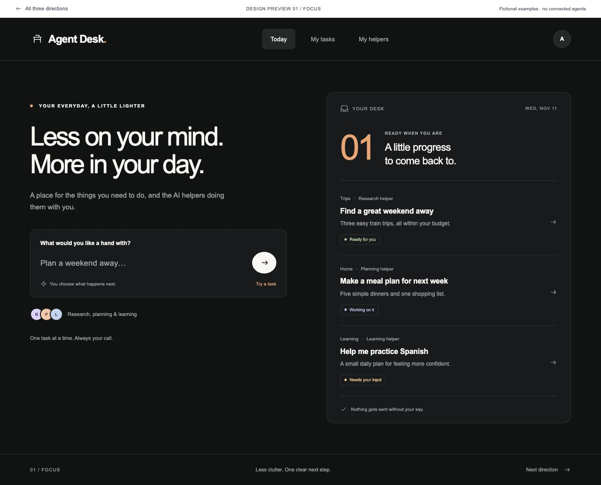
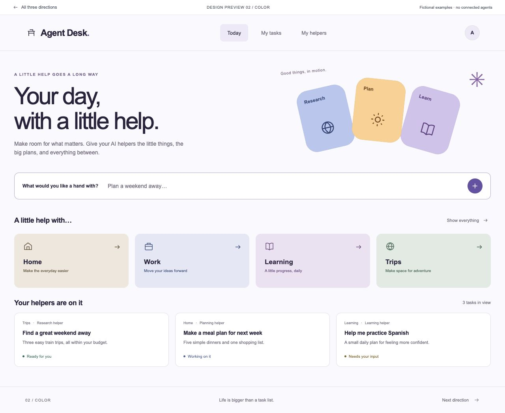
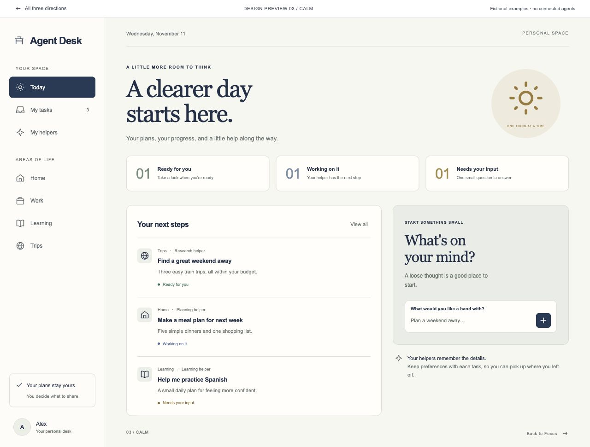

# Agent Desk: three visual directions for everyday people

November 11, 2026. **Decision status: previews for owner review. No final visual direction selected.**

## How the original direction was chosen

The warm white, olive, and green direction in the first pilot was an initial designer judgment: a restrained workspace with clear status and ownership. It was not established through competitor visual research, customer testing, or an owner-approved mood board. The agency/operator positioning came from the initial multi-brand workflow. The owner has now asked to explore an everyday-person audience and a researched visual direction.

## Three references, inspected directly

These are the three reference products previously discussed, not a claim about market share or a verified top-three ranking. Websites and the public demo were visually inspected, and Roma and Paperclip's published brand guides were read. The observations below separate the source's design from our adaptation.

| Reference                                                                     | Observed visual system                                                                                                                                                                                                          | What we adopt                                                                                               | Consumer adaptation                                                                                                                                                                    |
| ----------------------------------------------------------------------------- | ------------------------------------------------------------------------------------------------------------------------------------------------------------------------------------------------------------------------------- | ----------------------------------------------------------------------------------------------------------- | -------------------------------------------------------------------------------------------------------------------------------------------------------------------------------------- |
| [Roma](https://roma.app/brand)                                                | Black and white, orange-red accent; large Favorit display type, Inter interface text, with Eiko available for contrasting display. The homepage uses a dark grid and task-oriented examples.                                    | Strong type hierarchy, decisive contrast, a restrained accent, and an immediately understandable task view. | Focus: one request box and a short results inbox. Original peach accent and system typography; no copied wordmark or licensed fonts.                                                   |
| [Paperclip](https://paperclip.ing/brand/)                                     | Inter Tight display, Inter UI, mono for technical information; disciplined spacing and hairlines. Its live homepage includes colorful agent imagery against a dark background. The guide reserves its capsule motif for agents. | Clear hierarchy, meaningful color attached to helpers, and a visible sense of control.                      | Color: a lighter personal home, four familiar life areas, and original geometric helper illustrations. This light palette is our adaptation, not a claim about the homepage's palette. |
| [Retinue public demo](https://jklthinking.github.io/retinue/demo-en/?lang=en) | The neutral theme shows warm light surfaces, dark navy navigation, rounded bordered panels, colored state summaries, and detailed progress information. This is a synthetic public demo, not a live customer workspace.         | Legible progress and a recognizable sidebar/task structure.                                                 | Calm: three plain-language states and a daily planner. Serif headings are our addition. Infrastructure, workers, graphs, and quota tables are removed from the first view.             |

The references already reach beyond agencies: Roma shows personal tasks, and Paperclip's current homepage addresses individuals while retaining a work/team model. “For everyday people” is therefore an audience choice, not a unique competitive claim. [Roma homepage](https://roma.app/) · [Paperclip homepage](https://paperclip.ing/)

## The three previews

### 01 — Focus

**Feel:** quiet, direct, concentrated. Dark charcoal, warm white, peach accent. Large system sans-serif type, generous space, a single composer beside a compact inbox.

**Best for:** a person who wants to capture a thought and see the next result, with little navigation.

**Tradeoff:** the dark appearance can feel more technical and is less expressive about different parts of life.

### 02 — Color — recommended for this audience

**Feel:** friendly, optimistic, organized. Pale lilac canvas, original blue/apricot/lilac helper illustrations, clear Home/Work/Learning/Trips tiles.

**Best for:** a newcomer who understands everyday goals before they understand agents. Areas of life make the possible uses visible without requiring a tutorial.

**Tradeoff:** more elements compete for attention than in Focus. The illustrations should remain purposeful and secondary to the task entry point.

### 03 — Calm

**Feel:** familiar, steady, personal. Warm ivory, navy, muted green and gold; a serif greeting paired with practical sans-serif labels.

**Best for:** someone who already likes planners and wants to understand progress at a glance.

**Tradeoff:** the sidebar and summaries add structure and can feel closer to work software. Mobile hides secondary navigation and gives tasks more space.

## Shared product decisions

- Lead with a task or outcome: meal planning, learning, a personal project, or comparing trip ideas.
- Use “AI helpers” in first-use language, with “agents” available in connections/settings.
- Replace client-brand navigation with optional areas of life. Start with one personal space.
- Use “Ready for you,” “Working on it,” and “Needs your input.” Distinguish a draft from an external action.
- Preserve context separation underneath: a person's home and work accounts still need distinct identities and permissions.
- Make live account setup, privacy controls, activity history, and usage limits understandable before any consumer launch.

All three previews use the same fictional tasks. Add, open, filter, and review interactions are demonstrations in tab memory only. Reload resets them. No service calls or real agent executions occur. Summary counts reflect only the examples in the current tab, not live operational telemetry.

## What is intentionally not final

The working app's design, task storage, and brand-based model have not been migrated. The earlier brand document describes that original pilot and is superseded for audience exploration by [the consumer direction](consumer-direction.md). After the owner selects a direction, update the application, final brand brief, reusable design tokens, and actual onboarding together.

## Review standard

Compare first impression, task entry, readable hierarchy, clear state labels, keyboard access, and mobile flow. Use text and icons alongside status color. Previews provide focus indicators, native dialogs, labeled inputs, Escape-to-close, responsive layouts, and reduced-motion support. Desktop and mobile screenshots are supplied; this is a design review, not a complete accessibility certification or user study.

## Run the previews

From the repository root, run `python3 -m http.server 4318 --bind 127.0.0.1 --directory previews`, then open `http://127.0.0.1:4318/`. Only the preview folder is served. The app's private database and tokens are outside that folder.
